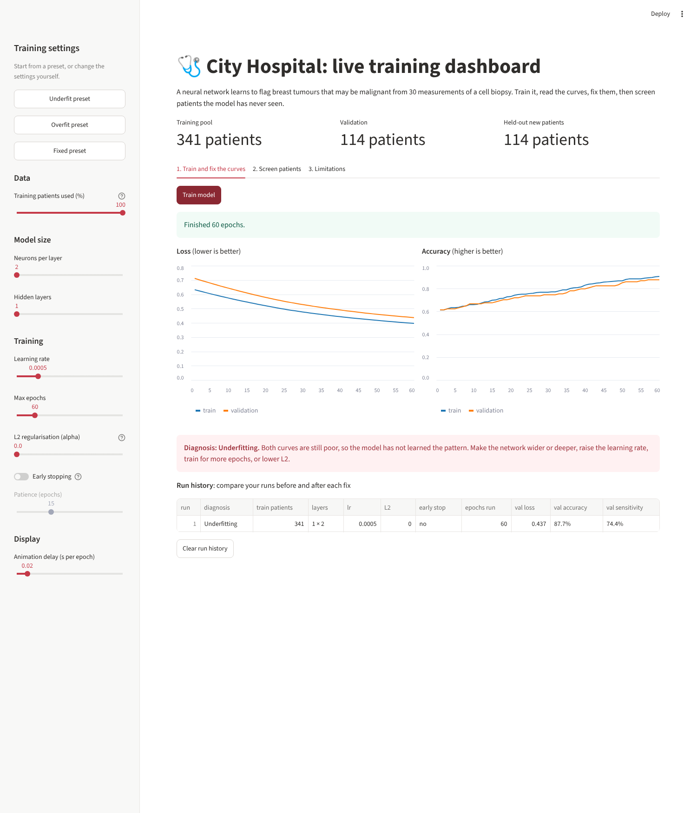
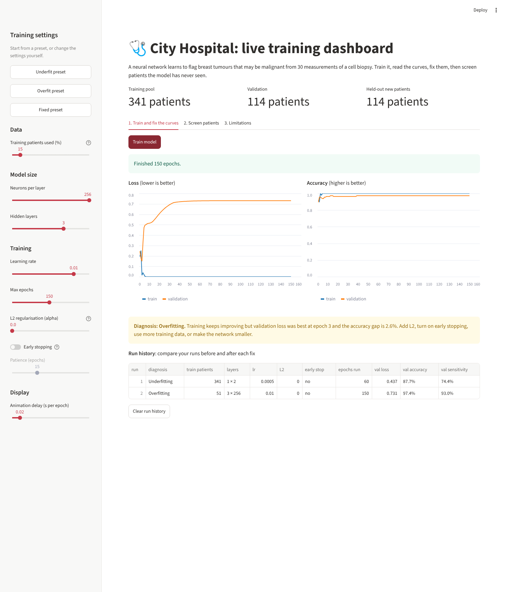
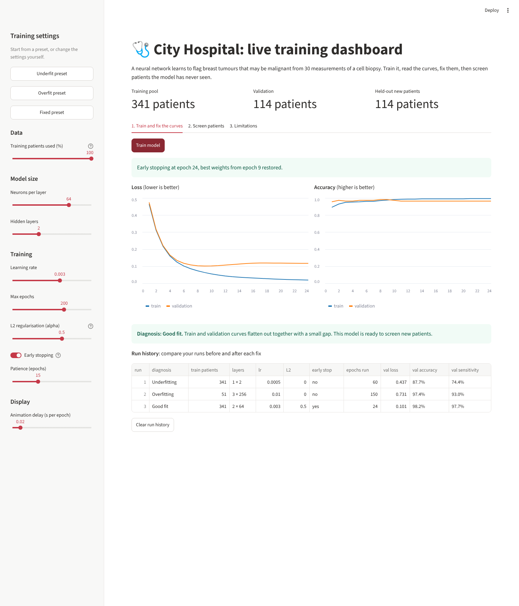
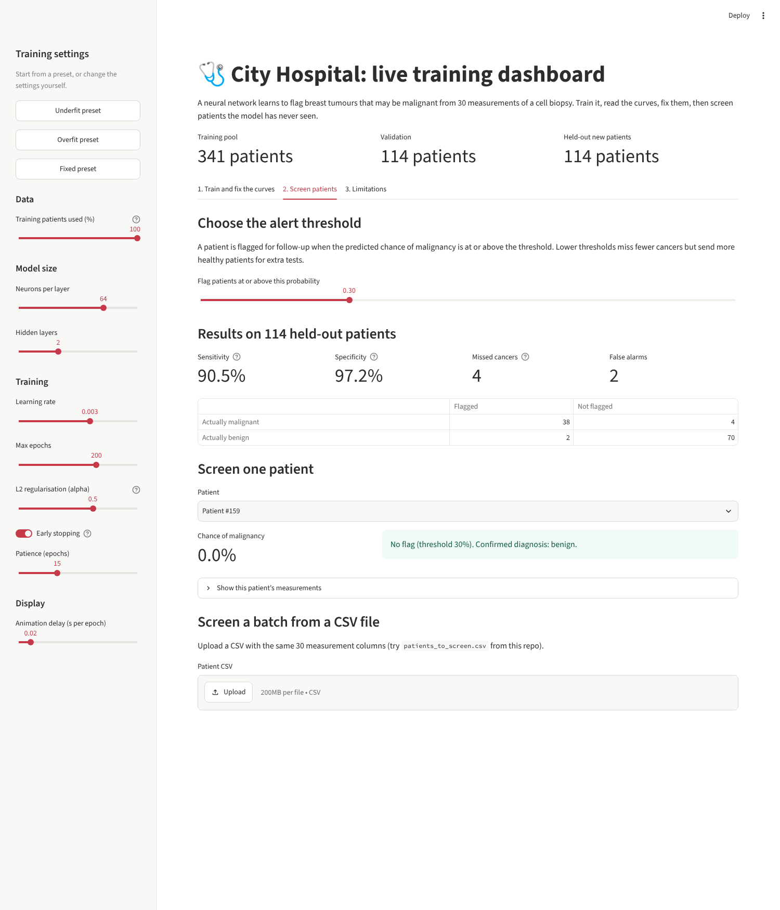
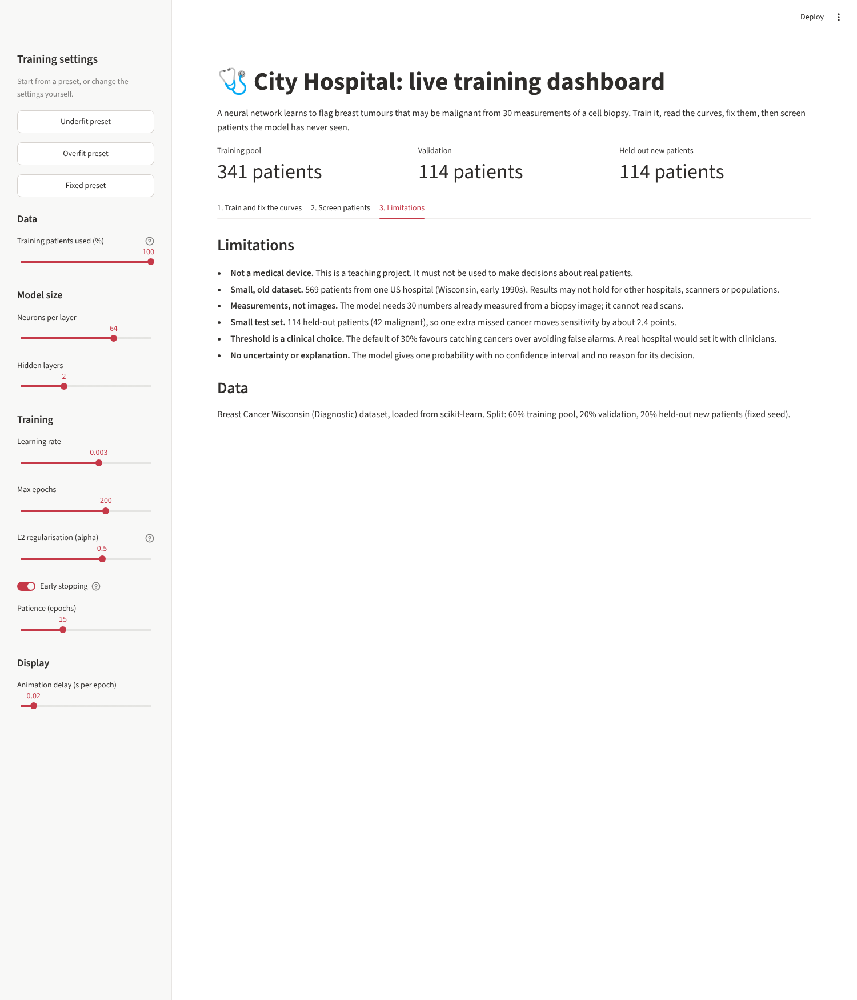

# Live training dashboard

**Client:** City Hospital
**Goal:** let staff watch a neural network train, see when it underfits or overfits, fix it live, and then use the finished model to screen patients it has never seen.

> ⚠️ Teaching project only. Not a medical device and not for real clinical decisions.

## Objectives

1. Train a model in the browser and **draw the loss and accuracy curves live**, epoch by epoch.
2. **Diagnose** the curves automatically (underfitting, overfitting or good fit) and suggest a fix.
3. Let the user **fix the curves** with controls for data size, model size, learning rate, L2 and early stopping.
4. **Screen held-out patients** with an adjustable alert threshold, reporting sensitivity, specificity and missed cancers.
5. Screen a **batch of patients from a CSV** and download the results.

## Workflow (designed on paper first)

```
Breast Cancer Wisconsin data: 569 patients, 30 biopsy measurements
        │
        ├── 20% held-out "new patients" (114)  ── used only in tab 2
        ├── 20% validation (114)               ── drawn on the curves
        └── 60% training pool (341)            ── slider can use only part of it
                    │
 sidebar settings → scale → MLP → train 1 epoch → record metrics → redraw charts
                                        ▲                               │
                                        └──── repeat / early stop ◄─────┘
                    │
        diagnose curves → show verdict + advice → add row to run history
                    │
 tab 2: pick threshold → screen 114 held-out patients → confusion matrix
        → screen one patient → upload CSV → download flagged list
```

## Features

| Tab | What it does |
|---|---|
| **1. Train and fix the curves** | Live loss and accuracy charts, automatic diagnosis, run history table to compare runs |
| **2. Screen patients** | Threshold slider, sensitivity/specificity/missed cancers on held-out patients, single-patient check, CSV batch screening with download |
| **3. Limitations** | What the model can and cannot be trusted with |

The sidebar has three presets (**Underfit**, **Overfit**, **Fixed**) to reproduce each situation in one click.

### How the diagnosis works (`core.diagnose`)

- **Underfitting:** final train and validation accuracy both below 93%.
- **Overfitting:** validation loss ended more than 10% above its best value (and the best was not near the end), or the train–validation accuracy gap is above 4 points.
- **Good fit:** otherwise. If early stopping ran, the restored best epoch is judged, not the last one.

## Setup

```bash
git clone https://github.com/YOUR-USERNAME/city-hospital-live-training-dashboard.git
cd city-hospital-live-training-dashboard
python -m venv .venv
source .venv/bin/activate          # Windows: .venv\Scripts\activate
pip install -r requirements.txt
streamlit run app.py
```

Then open http://localhost:8501. The dataset ships with scikit-learn, so nothing else needs downloading. Tested with Python 3.12, scikit-learn 1.9 and Streamlit 1.67.

**Suggested demo:** click **Overfit preset** → *Train model* → watch validation loss climb. Click **Fixed preset** → *Train model* → curves flatten together. Open tab 2 and move the threshold slider. Upload `patients_to_screen.csv` to screen a batch.

## Repository layout

```
.
├── README.md
├── requirements.txt
├── app.py                     ← Streamlit dashboard
├── core.py                    ← training, diagnosis and screening logic
├── patients_to_screen.csv     ← sample batch for the upload feature
└── screenshots/
```

## Code structure

- `core.py`: data splits, model builder, epoch-by-epoch training generator with early stopping, diagnosis and screening metrics. No Streamlit code, so it can be tested on its own.
- `app.py`: the Streamlit interface.
- `patients_to_screen.csv`: the 114 held-out patients' measurements (no labels), for the upload feature.

## Results

| Run | Settings | Epochs | Val loss | Val accuracy | Val sensitivity | Diagnosis |
|---|---|---|---|---|---|---|
| Underfit | 1×2 neurons, lr 0.0005 | 60 | 0.437 | 87.7% | 74.4% | Underfitting |
| Overfit | 3×256, 15% of data, lr 0.01, no L2 | 150 | 0.731 | 97.4% | 93.0% | Overfitting |
| Fixed | 2×64, all data, L2 0.5, early stop | 24 (best: 9) | 0.101 | 98.2% | 97.7% | Good fit |

In the overfit run, validation loss fell to about 0.15 by epoch 3 and then **rose to 0.73**, even though validation accuracy still looked fine. That is why we watch the loss, not just accuracy: the model became over-confident in its wrong answers.

**Screening the 114 held-out patients with the fixed model (threshold 30%):**

| | Flagged | Not flagged |
|---|---|---|
| Actually malignant (42) | 38 | **4 missed** |
| Actually benign (72) | 2 false alarms | 70 |

Sensitivity **90.5%**, specificity **97.2%**. Lowering the threshold catches more cancers at the cost of more false alarms; the slider shows the trade-off live.

## Screenshots

**Underfitting:** both curves stuck high


**Overfitting:** validation loss climbs while training loss reaches zero


**Fixed:** curves flatten together, early stopping keeps the best epoch


**Screening held-out patients**


**Limitations tab**


## Limitations

- **Not a medical device.** For learning only.
- **Small, old, single-site data:** 569 patients from one hospital in Wisconsin in the early 1990s. Performance may not transfer to other hospitals, equipment or populations.
- **Needs pre-measured features.** The model takes 30 numbers measured from a biopsy image; it cannot read images itself.
- **Small test set:** with 42 malignant test cases, one extra missed cancer changes sensitivity by about 2.4 points.
- **4 cancers still missed** at the default threshold. In a real screening setting that would need a lower threshold and clinical review.
- **No uncertainty or explanation.** One probability per patient, no confidence interval and no reason given.
- **State lives in the browser session.** Refreshing the page loses the trained model and run history; nothing is saved to disk.
